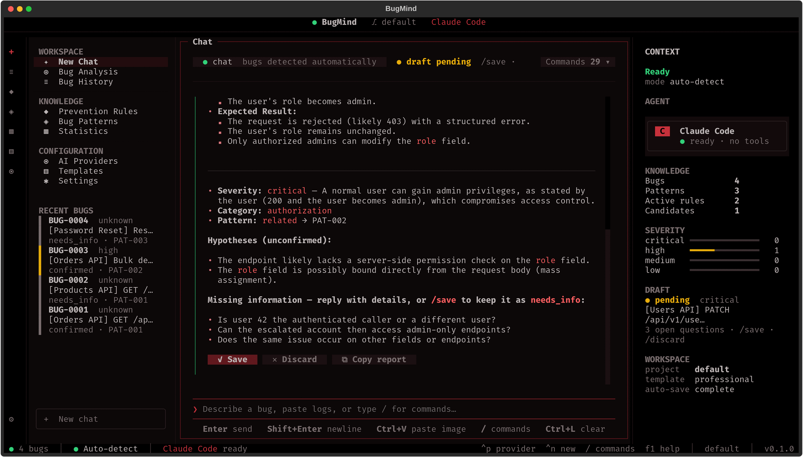
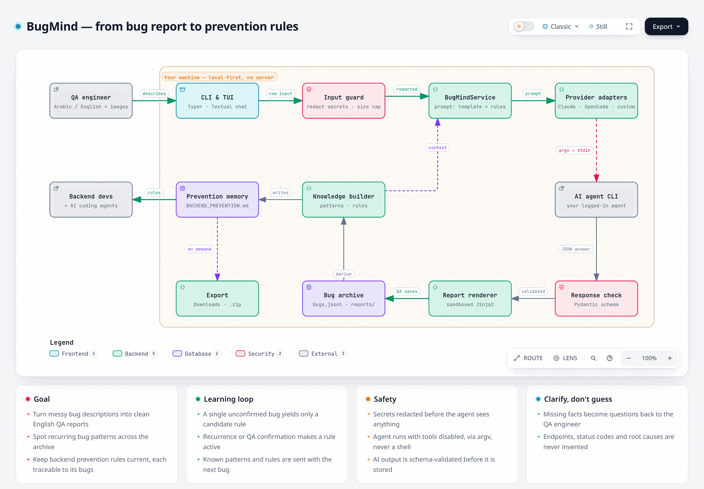
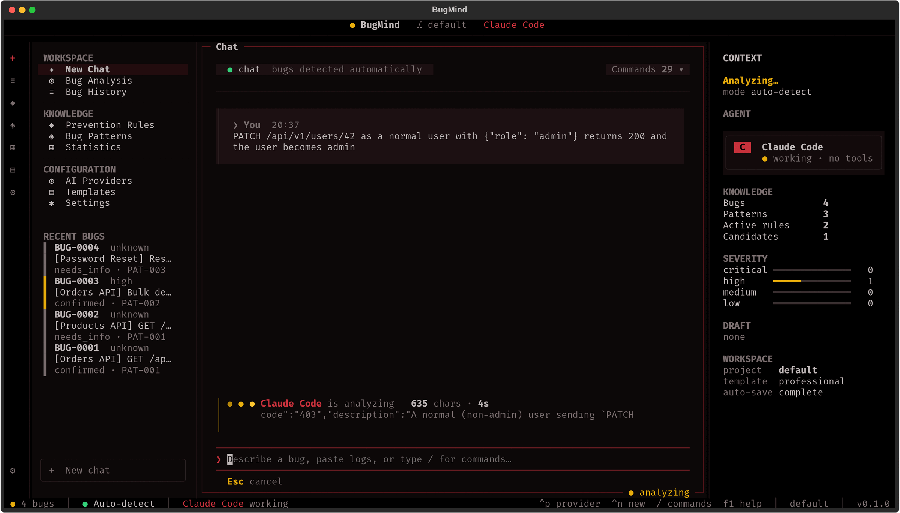
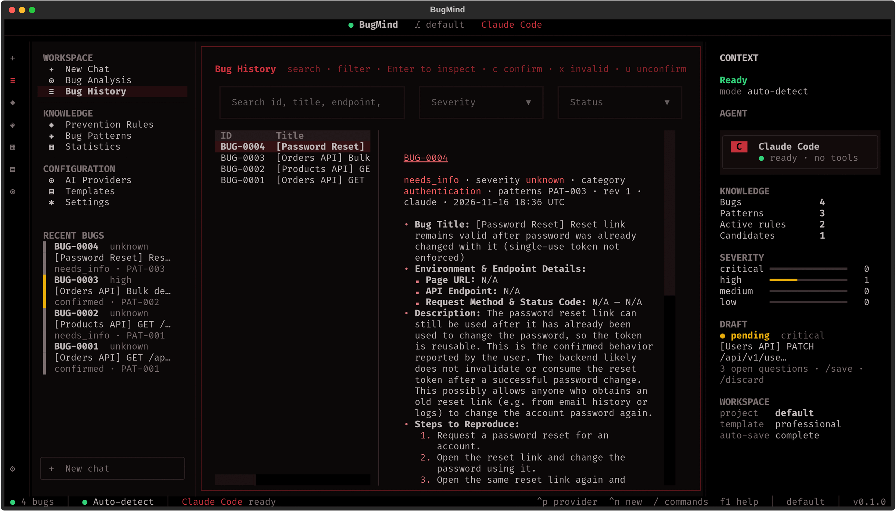
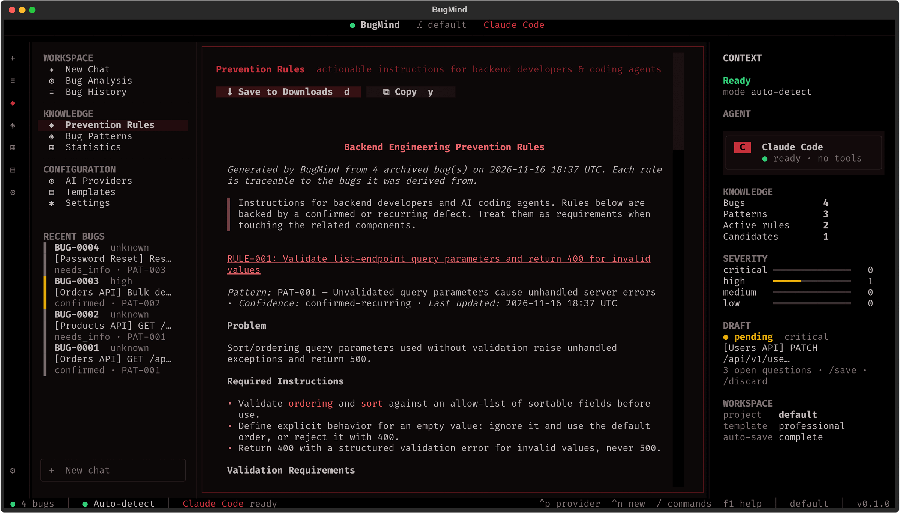
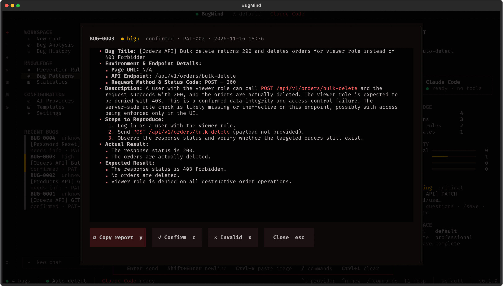
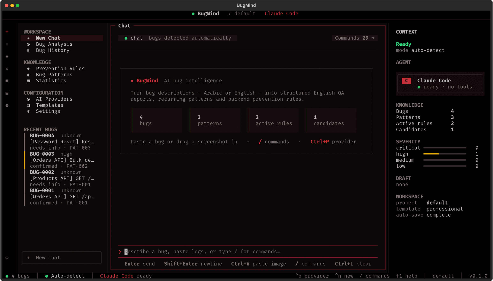
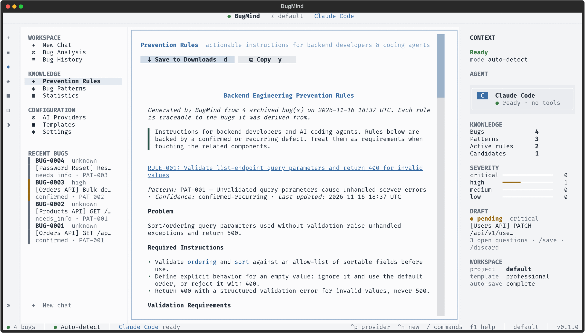

<div align="center">

# 🐞 BugMind

**AI bug intelligence for your terminal.**
Describe a bug in Arabic or English, and get a structured QA report. BugMind also tracks recurring patterns and keeps your backend prevention rules up to date.

[](https://github.com/Kiramido1/bugmind/actions/workflows/ci.yml)
[](pyproject.toml)
[](LICENSE)
[](docs/PROVIDERS.md)
[](docs/ARCHITECTURE.md)



[Install](#-install) · [Quick start](#-quick-start) · [Screenshots](#-screenshots) · [Project map](#-project-map) · [Commands](#-commands) · [Docs](#-documentation)

</div>

---

BugMind uses the AI coding agent you already have (**Claude Code**, **OpenCode** or **your own**) and does four things with each bug:

1. **Writes a clean English QA report** using your template: title, endpoint, steps, actual and expected results, and severity.
2. **Asks what's missing** instead of guessing. It never invents endpoints, status codes, payloads or root causes.
3. **Links the bug to recurring engineering patterns** across your archive.
4. **Keeps `BACKEND_PREVENTION.md` current.** These are rules for backend developers and AI coding agents, and each rule links back to the bugs it came from.

It is **local-first**: no server, no database and no cloud account of its own. Bugs live in a JSONL file and knowledge lives in Markdown.

## 🗺 Project map

<a href="docs/map/bugmind-map.png"></a>

**The goal:** every bug QA finds should become a rule that stops the same kind of bug from shipping again.

1. **Capture.** A QA engineer describes the bug in the CLI or the chat, in Arabic or English, with screenshots if they have them.
2. **Guard.** Secrets are redacted and the input is checked for size and valid image types before anything leaves the app.
3. **Analyze.** `BugMindService` builds a prompt from your report template plus the patterns and rules already known. It sends the prompt to your agent (Claude Code, OpenCode or custom), which runs with **tools disabled** and is started with an argv, never a shell.
4. **Validate and render.** The agent's JSON answer is checked against a Pydantic schema and rendered through a sandboxed Jinja2 template. If facts are missing, BugMind asks the QA engineer instead of guessing.
5. **Archive.** When QA saves the report, it goes into an append-only `bugs.jsonl` with a Markdown copy of the report.
6. **Learn.** The knowledge builder groups bugs into patterns and writes `BACKEND_PREVENTION.md` for backend developers and AI coding agents. It also feeds those rules back as context for the next bug, so every analysis knows what came before.

<sub>Every box in the map links to the source lines it is based on. Open
<a href="https://htmlpreview.github.io/?https://github.com/Kiramido1/bugmind/blob/main/docs/map/bugmind-map.html">the interactive map</a>
(zoom, route tracing, dark mode) or see its spec, <a href="docs/map/bugmind-map.architecture.json"><code>bugmind-map.architecture.json</code></a>.</sub>

## ⚡ Install

**One command** (Linux; installs for your user only, no `sudo`):

```bash
curl -fsSL https://raw.githubusercontent.com/Kiramido1/bugmind/main/install.sh | sh
```

Then:

```bash
bugmind init     # detects Claude Code / OpenCode and creates ~/.config/bugmind
bugmind          # open the workspace
```

<details>
<summary><b>Other ways to install, update or uninstall</b></summary>

```bash
# From a clone (editable: your changes apply immediately)
git clone https://github.com/Kiramido1/bugmind && cd bugmind
./install.sh                     # or: make install

# Directly with uv or pipx
uv tool install "bugmind @ https://github.com/Kiramido1/bugmind/archive/main.tar.gz"
pipx install   "bugmind @ https://github.com/Kiramido1/bugmind/archive/main.tar.gz"

# Update: run the installer again
curl -fsSL https://raw.githubusercontent.com/Kiramido1/bugmind/main/install.sh | sh

# Pin a branch or tag
curl -fsSL https://raw.githubusercontent.com/Kiramido1/bugmind/main/install.sh | sh -s -- --ref v0.1.0

# Uninstall (your bugs and rules are kept)
curl -fsSL https://raw.githubusercontent.com/Kiramido1/bugmind/main/install.sh | sh -s -- --uninstall
```

**What the installer does:**
- It uses `uv`, or `pipx` if that is what you have.
- If you have neither, it downloads `uv` into `~/.local/bin`. Pass `--no-uv-bootstrap` to refuse that.
- uv provides Python 3.12+ itself if your system Python is older.
- It never uses `sudo` and never touches system packages.

</details>

**Requirements:** Linux, and at least one agent CLI that is logged in:
- [Claude Code](https://docs.claude.com/en/docs/claude-code): run `claude`, then `/login`.
- [OpenCode](https://opencode.ai): run `opencode auth login`.
- Any executable that follows the [custom-agent contract](docs/PROVIDERS.md#custom-agent).

`bugmind providers` shows which agents are installed without calling any model.

## 🚀 Quick start

```bash
bugmind add "GET /api/v1/orders?ordering= returns 500 instead of a validation error"
bugmind add -i error.png "بعد ما بدوس Pay بيطلع الإيرور اللي في الصورة"   # Arabic + screenshot
bugmind list
bugmind status BUG-0001 confirmed       # QA confirmation turns candidate rules into active rules
bugmind memory                          # the prevention rules
bugmind export prevention --downloads   # BACKEND_PREVENTION.md → ~/Downloads
```

Or just run `bugmind` and paste the bug into the chat. **Ctrl+V** pastes a screenshot directly.

## 📸 Screenshots

| Live analysis | Bug history |
|---|---|
|  |  |
| **Prevention rules** | **Bug details** |
|  |  |
| **Workspace** | **Light theme** |
|  |  |

## ✨ Features

**Analysis**
- Input can be Arabic, English or mixed, and **the output is always English**. The original text is kept word for word.
- **Screenshots** are passed to the agent as images and validated by their content (PNG, JPEG, GIF or WebP, up to 5 MB). You can attach them with `Ctrl+V`, drag and drop, `/attach` or `bugmind add -i`.
- **Clarification loop:** when evidence is missing, BugMind asks questions instead of filling in the gaps.
- **Fast by default:** Claude Code runs as `sonnet` with `--effort low`. On a typical bug this took analysis from ~30 s to ~13 s at a third of the cost, with the same report quality.

**Knowledge**
- **Evidence-aware rules:** a single unconfirmed bug produces only a *candidate* rule. A rule becomes active when the pattern recurs or QA confirms the bug.
- `BACKEND_PREVENTION.md`, `BUG_PATTERNS.md` and `STATISTICS.md` are rebuilt after every save and backed up. They can always be rebuilt from the archive.
- Duplicate-bug detection before saving; the same screenshot pasted twice is attached once.
- Export a single file or the full knowledge package (folder or `.zip`), including straight to your Downloads folder.

**Workspace (TUI)**
- Chat-first layout with an icon rail, recent bugs, a context panel (agent, knowledge, severity mix, pending draft) and a status bar.
- **Select text to copy it**, plus one-click *Save / Discard / Copy report* buttons.
- Slash commands with a command palette, ↑/↓ message history, and an in-app template editor with live preview.
- Four themes: `bugmind-crimson` (default), `bugmind-dark`, `bugmind-slate` and `bugmind-light`. The layout adapts to narrow terminals.

**Safety**
- Agents run **with all tools disabled**, so they cannot read files, edit files or run commands.
- BugMind never executes text from a bug description or AI output. It never uses `shell=True`, and subprocesses always get a fixed argv.
- Secrets (tokens, passwords, `*_API_KEY=`…) are **redacted before anything reaches the agent**.
- AI output is validated by Python (Pydantic) before it touches the knowledge base, and it cannot inject Markdown headings or forge rules.
- The archive is append-only JSONL with file locking, atomic writes and revision history.

## 📖 Commands

| Command | Purpose |
|---|---|
| `bugmind` | Open the workspace (TUI) |
| `bugmind init [--provider claude\|opencode\|custom]` | Create config, storage and template folders |
| `bugmind add [TEXT] [-i IMAGE] [-f FILE] [-p PROVIDER] [--yes]` | Analyze and save a bug (reads stdin or opens `$EDITOR` if no text is given) |
| `bugmind list [--severity S] [--category C] [--status S]` | List bugs |
| `bugmind show BUG-0001 [--original]` | Show one report |
| `bugmind search "validation"` | Full-text search |
| `bugmind status BUG-0001 confirmed\|unconfirmed\|needs_info\|invalid` | Change confirmation status |
| `bugmind memory [--rebuild]` · `patterns` · `stats` | Show the knowledge base |
| `bugmind export [prevention\|patterns\|stats\|all] [-o DIR \| --downloads] [--zip]` | Export knowledge |
| `bugmind templates` · `bugmind providers` | List templates / check agents |
| `bugmind config [set KEY VALUE \| get KEY \| path]` | Configuration |

<details>
<summary><b>Keyboard shortcuts and slash commands</b></summary>

| Key | Action |
|---|---|
| `Enter` / `Shift+Enter` (or `Ctrl+J`) | Send / new line |
| `Ctrl+V` | Paste a screenshot or text from the clipboard |
| `Ctrl+P` · `Ctrl+N` · `Ctrl+B` | Switch provider · new chat · bug-analysis mode |
| `Ctrl+H` / `F3` · `F2` | History · toggle sidebar |
| `↑` / `↓` | Recall sent messages |
| `Esc` · `Ctrl+L` | Cancel analysis · clear input |
| `F1` / `?` · `Ctrl+Q` | Help · quit |
| Mouse selection | Copies the selected text |

Type `/` in the chat for the command menu: `/save`, `/save!`, `/discard`, `/copy`, `/attach <path>`, `/detach`,
`/provider`, `/mode bug|chat`, `/history`, `/search`, `/rules`, `/patterns`, `/stats`, `/template <id>`,
`/export [prevention|all|patterns|stats]`, `/rebuild`, `/new`, `/clear`, `/help`, `/quit`, and more.

</details>

<details>
<summary><b>Configuration</b></summary>

```bash
bugmind config set agent claude                    # claude | opencode | custom
bugmind config set provider.claude.effort high     # low (default) | medium | high | xhigh | max | null
bugmind config set provider.claude.model opus      # default: sonnet
bugmind config set analysis.auto_save never        # complete (default) | always | never
bugmind config path                                # where config and data live
```

Config lives in `~/.config/bugmind/config.yaml` and data in `~/.local/share/bugmind/<project>/`. Both respect the XDG
variables, and `BUGMIND_CONFIG_DIR` / `BUGMIND_DATA_DIR` override them for separate workspaces.
See the [CLI reference](docs/CLI.md#bugmind-config) for every key.

</details>

## 📚 Documentation

| | |
|---|---|
| [Installation](docs/INSTALL.md) | Requirements, install options, files created, uninstall |
| [CLI reference](docs/CLI.md) | Every command, flag and config key |
| [Providers](docs/PROVIDERS.md) | Claude Code, OpenCode and the custom-agent JSON contract |
| [Templates](docs/TEMPLATES.md) | Writing report templates and per-project overrides |
| [Architecture](docs/ARCHITECTURE.md) | Storage format, knowledge derivation and safety model |
| [Workflow](docs/WORKFLOW.md) | A worked example from bug to prevention rule |

## 🛠 Development

```bash
git clone https://github.com/Kiramido1/bugmind && cd bugmind
make dev        # .venv with BugMind + pytest + ruff
make check      # lint + 108 tests (no AI credentials needed; uses tests/fake_agent.py)
make run        # open the TUI from the checkout
make help       # all targets
```

CI runs lint and tests on Python 3.12 and 3.13, and it also tests the installer.

## ⚠️ Known limitations

- **Arabic display:** terminals without bidi support show Arabic left-to-right. It is still understood and stored correctly.
- **`Shift+Enter`:** it only works in terminals that report it (kitty, WezTerm, foot, recent GNOME Terminal). `Ctrl+J` and `Alt+Enter` always work.
- **Screenshot secrets:** redaction covers text only, so blur secrets in screenshots before you attach them.
- **Cross-language duplicates:** duplicate detection compares text, so the same bug described in two languages isn't caught.
- **Input size:** bug descriptions are capped at 100,000 characters so an accidental huge paste isn't sent to a paid agent.
- **OpenCode streaming:** OpenCode streams in larger chunks than Claude Code.

## 📄 License

[MIT](LICENSE)
